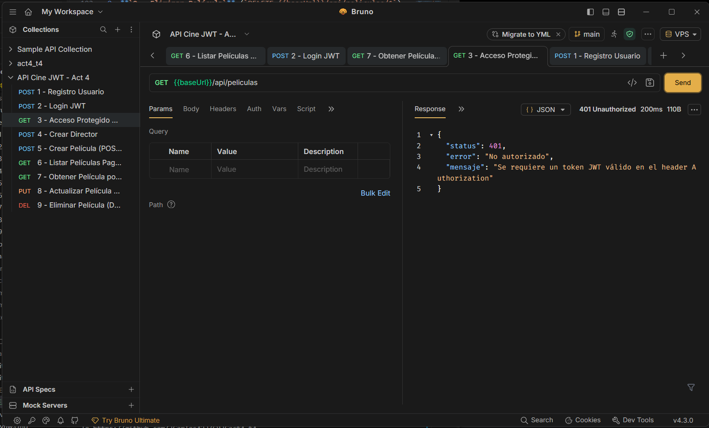
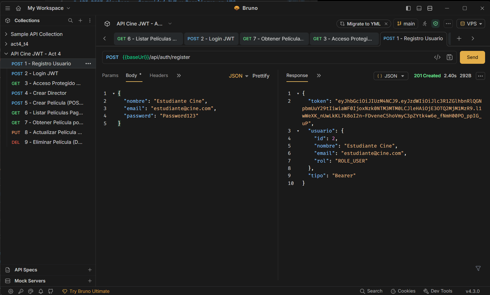
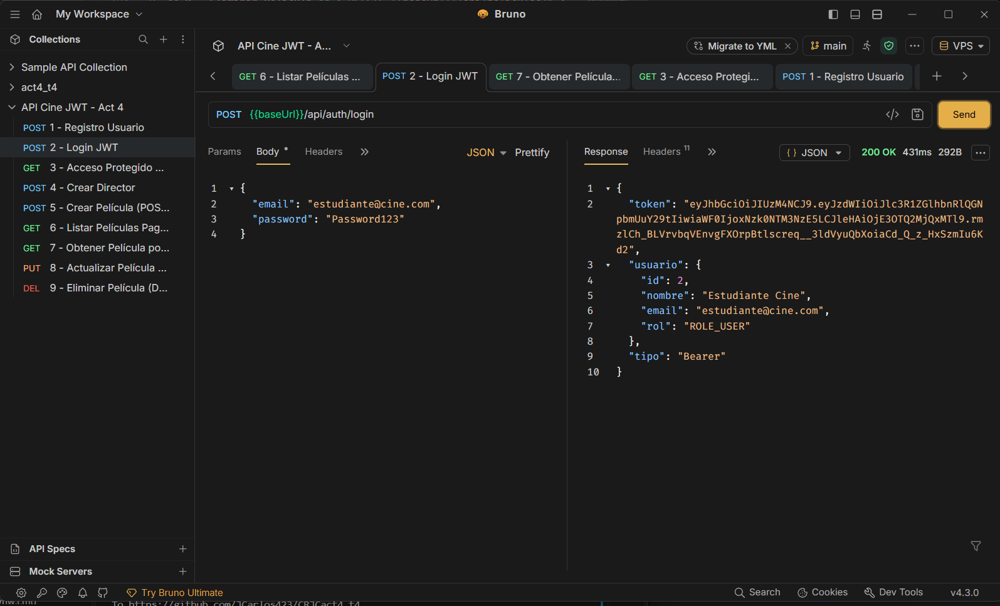
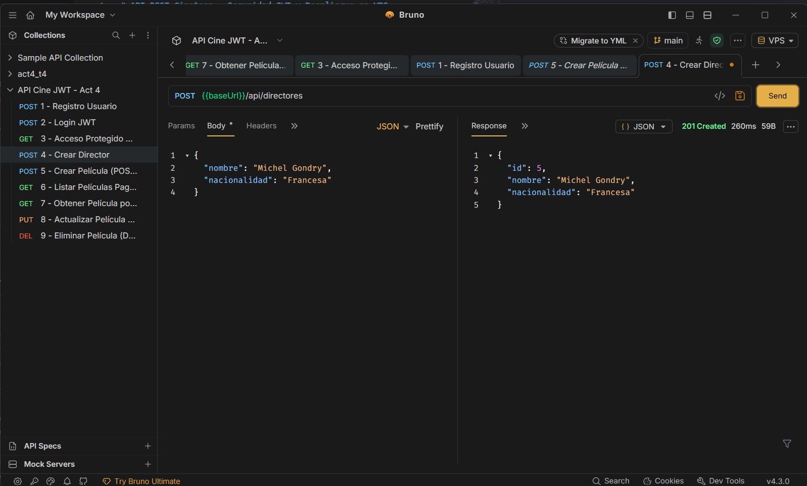
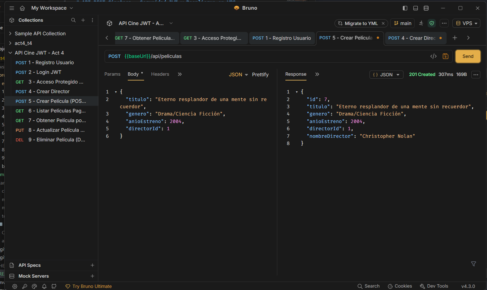
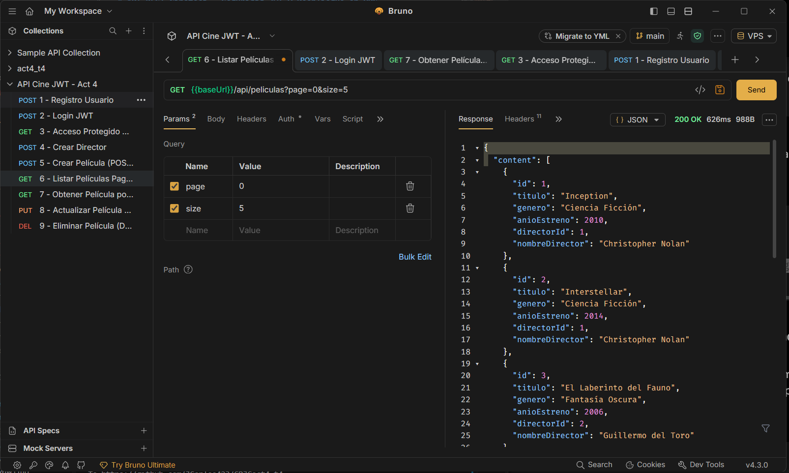
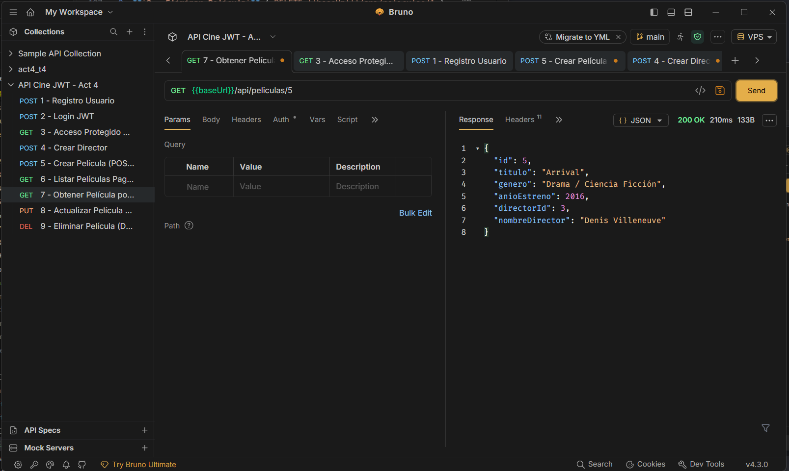
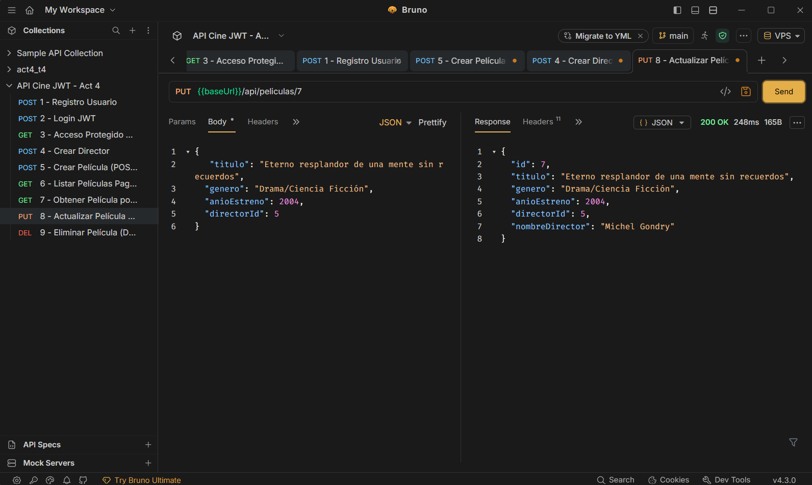
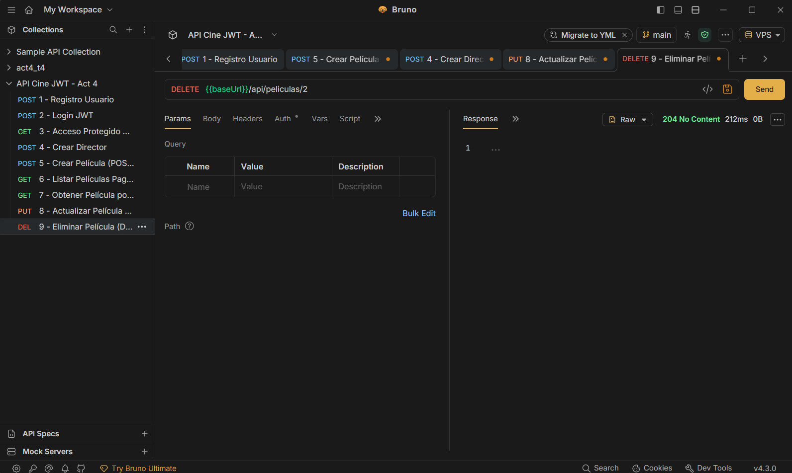

# API REST Cineteca — Seguridad JWT y Despliegue en VPS

API RESTful desarrollada con **Spring Boot** para la gestión de películas y directores, protegida mediante autenticación *stateless* con **Spring Security y JSON Web Tokens (JWT)**, persistencia en **MySQL** con **Spring Data JPA**, paginación de resultados y despliegue en producción sobre un servidor **VPS Ubuntu**.


## ⚙️ Configuración de Base de Datos y Entorno

### 1. Creación de la base de datos y usuario en MySQL

Ejecuta el siguiente script SQL en tu servidor MySQL (tanto en local como en el VPS):

```sql
CREATE DATABASE IF NOT EXISTS cinetecaact4
  CHARACTER SET utf8mb4
  COLLATE utf8mb4_unicode_ci;

CREATE USER IF NOT EXISTS 'cinefilo'@'localhost' IDENTIFIED BY 'TU_PASSWORD';
GRANT ALL PRIVILEGES ON cinetecaact4.* TO 'cinefilo'@'localhost';
FLUSH PRIVILEGES;
```

### 2. Archivo `src/main/resources/application.properties`

Configura las propiedades de conexión a MySQL, Hibernate y firma del token JWT:

```properties
spring.application.name=act4t_4
server.port=8087

# Base de datos MySQL
spring.datasource.url=jdbc:mysql://localhost:3306/cinetecaact4?useSSL=false&serverTimezone=UTC&allowPublicKeyRetrieval=true
spring.datasource.username=TU_USER
spring.datasource.password=TU_PASSWORD

# JPA / Hibernate
spring.jpa.hibernate.ddl-auto=update
spring.jpa.show-sql=true
spring.jpa.properties.hibernate.dialect=org.hibernate.dialect.MySQLDialect

# Configuración JWT (Clave en Base64 de al menos 256 bits y expiración de 24 horas)
jwt.secret=dGhpcy1pcy1hLXZlcnktc2VjdXJlLXNlY3JldC1rZXktZm9yLWp3dC1hY3Q0LXQ0LTIwMjY=
jwt.expiration=86400000
```

---

## Instalación y Ejecución en Local

1. Clona el repositorio y accede al directorio del proyecto:
   ```bash
   git clone <URL_DE_TU_REPOSITORIO>
   cd act4_t4
   ```

2. Compila y levanta el servidor en local con Maven:
   ```bash
   ./mvnw spring-boot:run
   ```

3. La API quedará escuchando en:
   ```text
   http://localhost:8087
   ```

---

## Despliegue en Producción (VPS Ubuntu)

1. **Empaquetar la aplicación en un `.jar` ejecutable:**
   ```bash
   ./mvnw clean package -DskipTests
   ```
   Esto generará el archivo `target/CRJCact4t_4-0.0.1-SNAPSHOT.jar`.

2. **Subir el artefacto al VPS y habilitar el puerto `8087` en el firewall:**
   ```bash
   ufw allow 8087/tcp
   ```

3. **Ejecutar la aplicación en segundo plano (`nohup`):**
   ```bash
   nohup java -Xmx256m -jar CRJCact4t_4-0.0.1-SNAPSHOT.jar \
     --server.port=8087 \
     --spring.datasource.url="jdbc:mysql://localhost:3306/cinetecaact4?useSSL=false&serverTimezone=UTC&allowPublicKeyRetrieval=true" \
     --spring.datasource.username=cinefilo \
     --spring.datasource.password='TU_PASSWORD' > appact4.log 2>&1 &
   ```

4. **Verificar que el servicio esté escuchando correctamente:**
   ```bash
   ss -tulnp | grep 8087
   tail -n 25 appact4.log
   ```

   * **URL Base en Producción:** `http://74.208.173.233:8087`

---

## Documentación de Endpoints

Todas las rutas bajo `/api/directores/**` y `/api/peliculas/**` están protegidas y requieren el encabezado HTTP:

```http
Authorization: Bearer <TU_TOKEN_JWT>
```

Si se omite el token o este es inválido/expirado, la API responde con **`401 Unauthorized`**.

### Autenticación (Rutas Públicas)

| Método | Endpoint | Descripción | Código Éxito |
| :--- | :--- | :--- | :--- |
| `POST` | `/api/auth/register` | Registra un nuevo usuario y devuelve su JWT | `201 Created` |
| `POST` | `/api/auth/login` | Autentica credenciales y devuelve un JWT | `200 OK` |

### Directores (Rutas Protegidas)

| Método | Endpoint | Descripción | Código Éxito |
| :--- | :--- | :--- | :--- |
| `POST` | `/api/directores` | Registra un nuevo director | `201 Created` |
| `GET` | `/api/directores` | Lista todos los directores registrados | `200 OK` |

### Películas (Rutas Protegidas)

| Método | Endpoint | Descripción | Código Éxito |
| :--- | :--- | :--- | :--- |
| `POST` | `/api/peliculas` | Crea una película vinculada a un `directorId` | `201 Created` |
| `GET` | `/api/peliculas?page=0&size=5` | Lista películas con soporte de paginación | `200 OK` |
| `GET` | `/api/peliculas/{id}` | Obtiene el detalle de una película por ID | `200 OK` |
| `PUT` | `/api/peliculas/{id}` | Actualiza los datos de una película existente | `200 OK` |
| `DELETE` | `/api/peliculas/{id}` | Elimina una película por ID | `204 No Content` |

---

##  Ejemplos de Peticiones (JSON)

### Registro de Usuario (`POST /api/auth/register`)
```json
{
  "nombre": "Estudiante Cine",
  "email": "estudiante@cine.com",
  "password": "Password123"
}
```

### Inicio de Sesión (`POST /api/auth/login`)
```json
{
  "email": "estudiante@cine.com",
  "password": "Password123"
}
```

### Crear Director (`POST /api/directores`)
```json
{
  "nombre": "Christopher Nolan",
  "nacionalidad": "Británica"
}
```

### Crear Película (`POST /api/peliculas`)
```json
{
  "titulo": "Inception",
  "genero": "Ciencia Ficción",
  "anioEstreno": 2010,
  "directorId": 1
}
```

---

## Pruebas con Bruno

El proyecto incluye una colección configurada para **Bruno** con dos entornos listos para alternar entre desarrollo y producción sin modificar las peticiones:

* **`Local`:** `baseUrl = http://localhost:8087`
* **`VPS`:** `baseUrl = http://74.208.173.233:8087`

### Secuencia recomendada de pruebas:

1. **`3 - Acceso Protegido Sin Token`** (`GET {{baseUrl}}/api/peliculas`) -> Valida el rechazo con estado `401 Unauthorized`.

2. **`1 - Registro Usuario`** (`POST {{baseUrl}}/api/auth/register`) -> Crea el usuario (`201 Created`) y guarda automáticamente el JWT en `{{token}}`.

3. **`2 - Login JWT`** (`POST {{baseUrl}}/api/auth/login`) -> Comprueba la autenticación con credenciales (`200 OK`).

4. **`4 - Crear Director`** (`POST {{baseUrl}}/api/directores`) -> Crea el director(`201 Created`).

5. **`5 - Crear Película`** (`POST {{baseUrl}}/api/peliculas`) -> Inserta una película asociada al director (`201 Created`).

6. **`6 - Listar Películas Paginado`** (`GET {{baseUrl}}/api/peliculas?page=0&size=5`) -> Verifica la respuesta paginada (`200 OK`).

7. **`7 - Obtener Película por ID`** (`GET {{baseUrl}}/api/peliculas/1`) -> Consulta individual (`200 OK`).

8. **`8 - Actualizar Película`** (`PUT {{baseUrl}}/api/peliculas/1`) -> Modificación de registro (`200 OK`).

9. **`9 - Eliminar Película`** (`DELETE {{baseUrl}}/api/peliculas/1`) -> Eliminación de registro (`204 No Content`).
